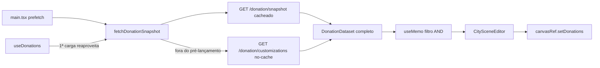

# Camada de API — Doações

Camada **só de dados**. Zero Three.js, zero React fora do hook. Busca doações do backend, aplica filtro client-side, entrega pro editor. Vive em `src/api/` (dados puros) + `src/components/hooks/useDonations.ts` (ponte React).

> [!important] Estilo de escrita
> Modo homem das cavernas. Corta artigo, enchimento, hedge. Fragmento OK.

## Por que existe

Antes: prédios nasciam no front (`INITIAL_TEST_DONATIONS`, 10 valores hardcoded). Agora: vêm do backend, snapshot cacheado, escala 100k+. IDs do backend preservados.

Pré-lançamento (`IS_PRELAUNCH`): cena usa sempre os 480 seeds do front, iguais em local e produção; doações e personalizações do banco não entram no cenário. Banco preservado, ONGs continuam no catálogo do ambiente. Simulações e edições locais da conta aplicadas sobre essa base. Fora do pré-lançamento, snapshot com doações segue como fonte; vazio usa seeds. Ver [[scene-hooks#Cidade inicial nos dois ambientes]].

## Arquivos

| Arquivo | Papel |
| --- | --- |
| `src/api/http.ts` | Instância axios. `baseURL = VITE_API_URL ?? "/api"`. Normaliza erro → `ApiError {status, message}`. |
| `src/api/donationApi.ts` | `fetchDonationSnapshot()` — busca snapshot, mapeia tuplas → objetos. Pré-lançamento não pede `/donation/customizations` (aparência é local). `prefetchDonationSnapshot()` — disparado no `main.tsx` (rota `/`), em paralelo ao chunk da cena. `loadDonationSnapshot()` — 1ª carga reaproveita essa promessa (e o progresso); resolvida, some. `saveDonationCustomization(id, customization)` — gravação local no balde do navegador; nenhuma escrita HTTP. Tipos `DonationRecord`/`City`/`Ong`/`DonationDataset`. |
| `src/api/regions.ts` | `UF_REGION` (27 UFs → 5 regiões) + `REGIONS`. Região é função fixa da UF — não vem do backend. |
| `src/components/hooks/useDonations.ts` | Hook. Carrega snapshot (`loadDonationSnapshot`; marca `cidoe:dados`), guarda dataset, aplica filtro (`useMemo`), expõe `loadState`/`donations`/`allDonations` (sem filtro)/`cities`/`ongs`/`savedCustomizations`/`filter`/`setFilter`/`retry`. |
| `src/components/hooks/useOwnedDonationIds.ts` | Hook. `ids` (`Set`) + `records` locais da conta; assina alterações após simulação. Vazio sem login; outra conta usa outras chaves. Ver [[#Quem pode editar]] e [[#Edifícios do usuário no login]]. |

## Contrato do snapshot

`GET /donation/snapshot` (proxy Vite `/api` → back). Formato compacto por tuplas:

```json
{ "v": 6, "total": 100000,
  "cities": [[2800308, "Aracaju", "SE"]],
  "ongs": [[1, "Instituto X", null]],
  "data": [[1, 42.5, 3550308, 7]],
  "beneficiaries": [[1, [7, 8]]] }
```

`ongs`: `[id, nome, profile_imageOuNull]`, só ativas. `Ong.profile_image` opcional no front: tupla antiga sem imagem vira `null`. Nome, foto e status administrados em [[ongs]]; cartões públicos usam foto ou iniciais. Cache do backend detecta exclusões pela contagem de ONGs, edições pela data com precisão fracionária; atualização em até 30 s, recebida ao recarregar dataset.

`data`: `[id, value, cityId, ongId]`. `fetchDonationSnapshot` desdobra em objetos `DonationRecord`.

`ongId` = ONG original, mantida na tupla por compatibilidade. `beneficiaries`: `[donationId, ongIds][]`, só edifícios com várias ONGs. `DonationRecord.ongIds` usa complemento ou `[ongId]` no snapshot antigo/edifício com uma ONG. Edifício aparece no filtro de qualquer ONG apoiada; card/menu mostram todos os nomes. Valor/altura continuam usando total acumulado.

Valor de cada ONG fica fora do snapshot: `fetchBuildingBeneficiaries(id, signal?)` → `GET /donation/:id/beneficiaries`, `[ongId, valor][]` maior primeiro (vazio = uma ONG, valor todo). Editor busca no clique só para edifício do banco com várias ONGs, e de novo se o valor mudar. Uma ONG = valor todo, sem request. Edifício simulado no pré-lançamento traz `DonationRecord.shares` (local, [[contribution-api]]). Uso: [[html-components#BuildingInfoModal.tsx]].

`cities` (v6): só cidades com edifício ativo. Antes vinha o IBGE inteiro (5.571, 99,7% do payload: 165 KB → <1 KB em produção). Catálogo completo dos formulários = `/location/cities`. Pré-lançamento: seeds e edifícios locais trazem a própria cidade.

`custom` saiu no v6: front não lia (cópia até 30 s velha). Personalização = `/donation/customizations`.

`GET /donation/customizations`: `[donationId, BuildingCustomization][]`, só dos edifícios personalizados. `Cache-Control: no-cache` + ETag: lida do banco em cada carga, 304 sem corpo quando nada mudou. `hologramImage` vem como URL versionada (`/api/donation/{id}/hologram.{ext}?v=…`), nunca a data URL. Fora do pré-lançamento, `fetchDonationSnapshot` dispara as duas em paralelo e usa esta para montar `DonationDataset.customizations` (Map); no pré-lançamento ela não é pedida.

Nginx: `expires off` no `/api` — cabeçalho de cache da API chega intacto (antes o `expires -1` do server virava tudo `no-cache`).

## Gotcha: barra de progresso com gzip

Resposta vem `Content-Encoding: gzip`. Browser zera `ProgressEvent.total` e conta `loaded` em bytes **descomprimidos**. Logo `Content-Length` (tamanho gzip) não serve de denominador.

Solução: back manda header `X-Snapshot-Bytes` = tamanho do JSON raw. `donationApi` lê ele via `event.event?.target.getResponseHeader(...)` (headers chegam antes do body). Sem o header → `totalBytes: null` → overlay mostra só MB carregados, sem %.

## Filtro client-side

Dataset inteiro já é **público** (id, valor, cidade, ONG — sem dado de doador). Filtrar no front NÃO delega segurança ao cliente — só escolhe o que renderizar. ~5ms p/ 100k.

Predicado AND no `useMemo`:
- `ongId` combina com qualquer nível de local; corresponde a qualquer item de `DonationRecord.ongIds`.
- Local usa o mais específico presente: `cityId` > `uf` > `region`.
- Região deriva da UF via `UF_REGION[cidade.uf]`.
- `cityById` (Map) montado 1× pra lookup O(1).

Sem filtro → retorna array original (mesma referência, evita rebuild à toa).

## Fluxo



Editor chama `setDonations(donations)` a cada mudança de `donations` (load inicial + troca de filtro). Replace-all na cena — doação manual local é descartada ao trocar filtro. Ver [[scene-managers#setDonations]].

## Personalização persistida

Pré-lançamento: edição salva no localStorage, nunca em `donation.customization`. `savedCustomizations` mescla personalização pública → cópia antiga da conta → balde do navegador (`guest`, vence). Editor reaplica após `setDonations`, preserva payloads pendentes e salva ao fechar/recarregar (`pagehide`). Debounce 500 ms por edifício; sem conta, login/logout não perde edição.

### Quem pode editar

Beta aberto: qualquer visitante, logado ou não, administra qualquer edifício. Sem `canEdit`. Alteração vale só no navegador. Configurações da cena, botão e `Ctrl+M` apenas para admin.

### Edifícios do usuário no login

`useOwnedDonationIds`: lê edifícios locais, sem `/donation/me`. `useDonations`: mescla edifícios da conta no snapshot para renderização, sem incorporá-los ao dataset público. Troca de conta/logout remove registros anteriores imediatamente; a próxima conta restaura suas próprias chaves. Filtros usam cidades do snapshot mais cidades dos edifícios locais.

## Estados de carga

Snapshot continua com loading/progresso/erro/retry. Mutação local dispara evento específico da chave; outras abas recebem `storage`. Armazenamento inválido/cheio/bloqueado exibe erro e mantém dados gravados anteriormente.

## Acesso aos próprios edifícios

**Meus edifícios** no `AuthMenu` e **Ver meu edifício** na confirmação da simulação usam `handleOpenDonation(id, false)`: lista local sem filtro, ativam `myBuildingsOpen`, ocultam interface geral e levam direto ao próprio. Card compacto no topo esquerdo, setas laterais em ciclo, **Personalizar/Ver como visitante** no rodapé e **X** para sair/restaurar UI. Clicar na cena encerra o modo: no chão limpa foco, em outro edifício abre as informações dele. **Ver na cidade** no `GameMenu` mantém o card normal. Troca de conta/sair cancela foco pendente e restaura UI. **Administrar/Personalizar** mantém abas Informações/Aparência. Valores do menu e da seção pública rotulados como simulados.

Detalhes: [[index#Pré-lançamento]], [[contribution-api]], [[html-components]].
