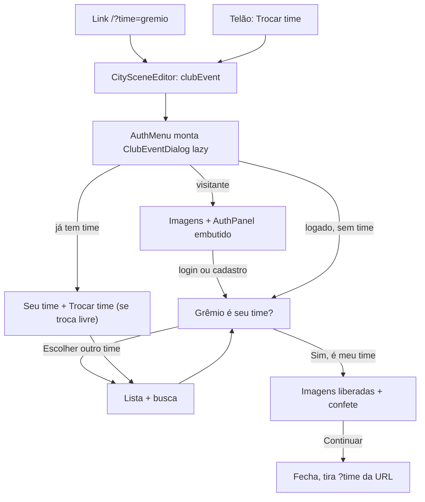

# Evento dos times

Usuário abre link do time, confirma que torce (ou escolhe outro) e ganha **3 imagens do time** pro telão de LED do edifício. Telão só usa imagens do evento: sem time, sem aba Telão.

> [!info] Regra mora no backend
> Time e troca única gravados em `user_club` (back, `doc/modulos/club/club.md`). Front só mostra; `canChange` vem da API.

## Fluxo

- **Link**: `https://cidoe.com.br/?time=<slug>` (slug = pasta em `public/clubes`). Slug inválido ou `?time` vazio → lista (sem time) ou time atual (com time). Modal abre com cidade pronta (AuthMenu monta no boot), por cima de tudo.
- **Visitante**: mesmo modal mostra as 3 imagens + `AuthPanel` (Google ou e-mail, indicação do `?ref=` preservada). Login/cadastro dentro dele → segue pra oferta, sem trocar de modal. AuthMenu passa o modal com a mesma `key` nos dois ramos (logado/visitante): login não remonta.
- **Oferta** (`"<Time> é seu time?"`): `Sim, é meu time` (âmbar = conquista) grava; `Escolher outro time` abre lista. Escolha da lista volta pra oferta do time escolhido. Já tem time → kicker `Seu time: <atual>` acima: aceitar = trocar, sem texto explicando.
- **Conquista**: confete (`RewardConfetti`, some com movimento reduzido), `Imagens liberadas`, `Continuar` fecha.
- **Já tem time**: mesmo link mostra o time. Troca livre → `Trocar time`. Troca usada → só `Continuar`; link de outro time também mostra o time atual. Nada explica a regra: botão some. `canChange` do servidor decide sozinho (slug desconhecido no front não destrava).
- **Fechar** (X, Esc, fora): fecha e tira `?time` da URL (recarregar não reabre). Durante gravação não fecha.
- **409** (troca usada em outra aba): mensagem da API na tela, estado relido.

### Nada por cima

Enquanto aberto (`clubEvent !== null`):

| Modal automático | Como espera |
|---|---|
| Indicação (`ReferralDialog`), conquistas (`RewardDialog`), onboarding do 1º login | condição `!clubEventOpen` no `AuthMenu` |
| Pré-lançamento (20 s), saída do visitante | esperam `[role=dialog][data-state=open]` (`OPEN_DIALOG`) e, no editor, `clubEvent === null` — cobre o instante em que o chunk do modal ainda baixa |
| Demais (menu, contribuição, login, vídeo) | só abrem por clique: overlay bloqueia |

Cadastro dentro do modal → onboarding aparece **depois** que o evento fecha. `Trocar time` no telão abre o modal por cima do editor (último aberto = topo).

## Telão

Aba **Telão** do [[html-components#BuildingCustomizer.tsx|BuildingCustomizer]] só existe com time: 3 imagens dele, rótulo = nome do time, `N/3`. `Trocar time` ao lado de `Remover telão` enquanto troca livre. Troca gravada → `handleClubChosen` (editor) leva todo telão montado para as mesmas posições do time novo (`gremio/2` → `flamengo/2`, ordem mantida) e salva. Telão nunca mistura times.

`BuildingManageDialog` chama `useMyClub` ao montar (junto com o chunk do personalizador) e passa `club` + `onChangeClub`.

## Peças

| Arquivo | Papel |
|---|---|
| `public/clubes/<slug>/{1,2,3}.webp` | 256 px, 1 = escudo. `thumb.webp` 96 px (lista) |
| `scripts/encode-clubs.mjs` | PNG 1254 px → WebP (`npm run clubs:webp`). Fonte padrão `../cidoa-back/clubes`; escudo por nome (Escudo > Brasão > Emblema > Distintivo > Medalhão) + exceção `caxias` |
| `src/lib/clubs.ts` | 66 times (slug + nome, ordem alfabética), `findClub`, `clubImages`, `searchClubs` (sem acento, prefixo de palavra antes de trecho). Só nos chunks lazy (2,4 KB) |
| `src/scene/textures/screenImageManifest.ts` | key `"<slug>/<n>"` → `/clubes/<slug>/<n>.webp`; formato fechado, sem lista. Ver [[scene-textures#Imagens do telão]] |
| `src/api/club/club.routes.ts` | `getMyClub` (`GET /club/me`), `chooseClub` (`PUT /club/me`) |
| `src/components/hooks/useMyClub.ts` | estado compartilhado por conta: 1 pedido por carregamento, só quando modal ou editor monta. Escolha atualiza telão aberto |
| `src/components/club/ClubEventDialog.tsx` | modal (lazy): login, carregando, erro, lista, oferta, meu time, conquista |
| `CitySceneEditor` | `clubEvent` (lê `?time`; `pick` = abrir na lista), `closeClubEvent` (limpa URL), `openClubList` (Trocar time), `handleClubChosen` (migra telões) |
| `AuthMenu` | monta o modal com `AuthPanel` da indicação; segura indicação/conquistas/onboarding |

## Desempenho

- Boot da cidade: zero bytes e zero pedido do evento. Sem `?time`, modal nem baixa.
- Modal: chunk próprio + 3 imagens (~35 KB). Lista: miniaturas `loading="lazy"` (~2,7 KB cada).
- Telão: `GET /club/me` só ao abrir o editor. Cena resolve URL pela key (sem catálogo no chunk da cena).
- `public/` sem hash: nginx guarda 30 dias. Trocar imagem = trocar nome do arquivo.

## Time novo

1. Pasta `<slug>` com 3 PNGs na fonte → `npm run clubs:webp` (confere escudo na miniatura).
2. Linha em `CLUBS` (`src/lib/clubs.ts`).
3. Slug em `CLUB_SLUGS` do back (`src/modules/club/schema/club.schema.ts`).
4. `node scripts/check-club-event.mjs` (compara os três).

## Verificação

- `node scripts/check-club-event.mjs` — lista × arquivos × back, key do telão, busca e todos os estados do modal real; sem servidor/navegador.
- `node scripts/check-building-customizer.mjs` — aba Telão por time.
- `node scripts/check-led-screen-ui.mjs` (dev server + API + Chrome; `MOBILE=1`, `SHOTS=pasta`) — evento inteiro no app: login no modal, oferta, lista, conquista, onboarding depois, telão, Trocar time por cima do editor. API da conta simulada por interceptação: não cria conta nem manda e-mail.

> [!warning] Antes de divulgar
> Imagens são escudos, mascotes e estádios de clubes reais, servidos pelo Cidoe. Risco de marca/direito autoral alto sem licença (Lei Geral do Esporte arts. 168–170, LPI, LDA). Termos sem cláusula de marcas de terceiros. Decisão do dono antes de publicar.
