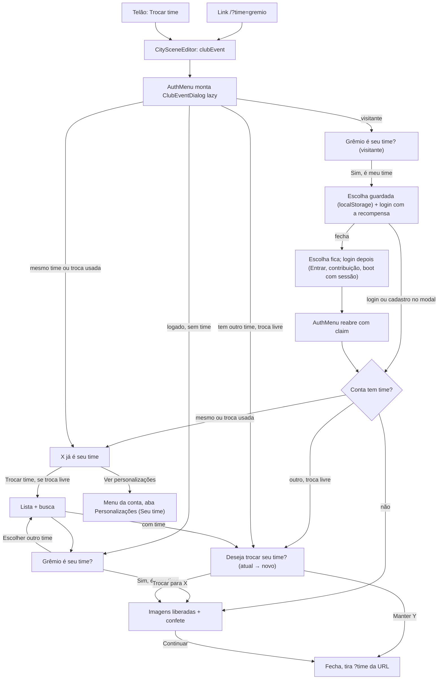

# Evento dos times

Usuário abre link do time, confirma que torce (ou escolhe outro) e ganha **as imagens do time** pro telão de LED do edifício. Telão só usa imagens do evento: sem time, sem aba Telão.

> [!info] Regra e catálogo moram no backend
> Times, imagens e liga/desliga no banco, administrados em `/dale/times` ([[evento-times-admin]]). Time e troca única em `user_club` (back, `doc/modulos/club/club.md`). Front só mostra; `canChange` e `isActive` vêm da API.

## Fluxo

- **Link**: `https://cidoe.com.br/?time=<slug>` (slug do catálogo; painel copia). Slug inválido, time inativo ou `?time` vazio → lista (sem time) ou time atual (com time). Modal abre com cidade pronta (AuthMenu monta no boot), por cima de tudo.
- **Catálogo** (`GET /club/catalog`, `useClubCatalog`): carregando → modal não aparece (sem piscar; editor segue segurando os outros modais). Erro → tela de erro + Tentar de novo. **Evento desligado** → `onClose` sem aparecer (limpa `?time`).
- **Visitante**: escolhe igual a quem não tem time (oferta, lista). **Sim, é meu time** guarda a escolha no navegador (`cidoe:club-pending`, [[#Recompensa do visitante]]) e mostra o login com a recompensa: desktop = moldura do vídeo de apresentação (`SplitDialogContent`), recompensa (Seu time + nome + imagens + "Entre para ganhar…" + **Escolher outro time**) no lugar do vídeo, `AuthPanel` à direita; mobile = recompensa + **Entrar** → `AuthPanel` toma o modal (teclado). Google ou e-mail, indicação do `?ref=` preservada. Login/cadastro dentro dele → grava sozinho (já disse sim) → conquista, sem trocar de modal. AuthMenu passa o modal com a mesma `key` nos dois ramos (logado/visitante): login não remonta.
- **Oferta** (sem time, `"<Time> é seu time?"`): `Sim, é meu time` (âmbar = conquista) grava; `Escolher outro time` abre lista. Escolha da lista volta pra oferta do time escolhido.
- **Troca** (tem time, troca livre, link ou lista com outro time): `Deseja trocar seu time?` + "O telão passa a mostrar o novo time. Esta é sua única troca." Lado a lado: **Seu time** (escudo apagado/cinza) → **Novo time** (moldura verde). `Trocar para <novo>` (verde, não âmbar: é troca) grava → conquista; `Manter <atual>` fecha; `Escolher outro time` abre lista.
- **Conquista**: confete (`RewardConfetti`, some com movimento reduzido), `Imagens liberadas`, `Continuar` fecha.
- **Já tem time** (mesmo link, link sem time/inválido ou troca usada): `<Time> já é seu time` + "As imagens já estão nas suas personalizações." + imagens. `Ver personalizações` (principal) fecha o modal (limpa `?time`) e abre o menu da conta na aba **Personalizações**, onde `MyClubImages` mostra **Seu time: X** com as imagens. Troca livre → `Trocar time`. Troca usada → link de outro time também cai aqui, sem opção de troca (botão some). `canChange` do servidor decide sozinho (slug desconhecido no front não destrava). Time desativado pelo admin segue aparecendo pra quem torce (só não é oferecido).
- **Fechar** (X, Esc, fora): fecha e tira `?time` da URL (recarregar não reabre). Durante gravação não fecha.
- **409** (troca usada em outra aba): mensagem da API na tela, estado relido.

### Recompensa do visitante

Escolha do visitante nunca se perde por fechar, recarregar ou entrar por outro caminho. Guarda em `src/lib/clubPending.ts` (`localStorage` `cidoe:club-pending` = `{ club, at }`, validade 30 dias, valor estranho/corrompido = nada, storage bloqueado = vale só com o modal aberto). Política de Privacidade lista a chave.

| Cenário | O que acontece |
|---|---|
| Visitante confirma time | Guarda; login com a recompensa. Nada no servidor |
| Confirma outro (Escolher outro time → lista → oferta → Sim) | Substitui a guardada |
| Fecha antes de entrar (X, Esc, fora) | Escolha fica; `?time` sai da URL. Sem lembrete automático (nada empilha) |
| Entra dentro do modal, conta sem time | Grava sozinho (`PUT /club/me`) → conquista. Loader no lugar da oferta: não pergunta de novo |
| Entra depois por outro caminho (Entrar, contribuição, indicação, saída) ou volta com sessão | `AuthMenu` lê a escolha 1× por login e abre o modal com `claim` quando a tela está livre (login fechado, `onboardingBlocked` falso: contribuição, editor, card…). Até lá segura indicação, conquistas e onboarding como se o evento já estivesse aberto: onboarding da conta nova não pisca antes |
| Conta já tem outro time, troca livre | **Deseja trocar seu time?** (atual → escolhido): troca gasta a única troca, então pergunta. **Manter** consome a escolha |
| Conta com troca usada | **"<Time atual> já é seu time"** + Ver personalizações |
| Conta já tem o mesmo time | **"<Time> já é seu time"** |
| Conta com etapa obrigatória (main: termos) | Etapa antes; grava depois. Fechar na etapa mantém a escolha |
| Falha passageira ao gravar (rede, 401, 403 evento fechado, 5xx) | Erro na oferta, **Sim** tenta de novo, sem laço. Fechar mantém → próximo login/boot tenta |
| Recusa definitiva (400 time indisponível, 409 troca usada) | Mostra o estado; fechar consome |
| Evento desligado ao resgatar | Modal não aparece; escolha fica (admin pode religar) até vencer |
| Catálogo/time com erro ou carregando | Fechar mantém |
| Time desativado depois da escolha | Lista; escolha da lista pede **Sim** (não grava sozinha). Fechar consome |
| Logado aceita outro time por link | Escolha mais recente vence: guardada sai |
| Logout → escolhe como visitante → entra de novo | Relida no novo login |

Regra de consumo: logado fechando em oferta, lista, troca, meu time ou conquista (ou **Ver personalizações**) apaga; gravação bem-sucedida apaga. Fora isso, fica. Limite: só no navegador da escolha (visitante não tem identidade pra ligar a outro aparelho).

### Nada por cima

Enquanto aberto (`clubEvent !== null`):

| Modal automático | Como espera |
|---|---|
| Indicação (`ReferralDialog`), conquistas (`RewardDialog`), onboarding do 1º login | condição `!clubEventOpen` no `AuthMenu` (`clubEventOpen` inclui resgate esperando a tela livre) |
| Pré-lançamento (20 s), saída do visitante | esperam `[role=dialog][data-state=open]` (`OPEN_DIALOG`) e, no editor, `clubEvent === null` — cobre o instante em que o chunk do modal ainda baixa |
| Demais (menu, contribuição, login, vídeo) | só abrem por clique: overlay bloqueia |

Cadastro dentro do modal → onboarding aparece **depois** que o evento fecha. `Trocar time` no telão abre o modal por cima do editor (último aberto = topo).

## Telão

Aba **Telão** do [[html-components#BuildingCustomizer.tsx|BuildingCustomizer]] só existe com time no catálogo: todas as imagens dele (até 12), rótulo = nome do time, `N/máx` (máx = `min(4, imagens)`). **Nome**: faixa embaixo da imagem com nome ou apelido (`screenLabel`; apelido só aparece se o time tem — admin cadastra quando quiser). Grava só a escolha: texto vem do catálogo, então troca de time e apelido novo chegam sozinhos. `Trocar time` ao lado de `Remover telão` enquanto troca livre **e** evento ligado. Troca gravada → modal passa `remap` (`remapScreenImages`) e `handleClubChosen` (editor) leva todo telão montado para a **mesma posição** do time novo (2ª imagem → 2ª imagem, ordem mantida; sem par no time novo → sai) e salva. Mesma regra do servidor. Telão nunca mistura times.

Key gravada = `"<slug>/<n>"`, `n` = número estável da imagem (não a posição: admin remove imagem e os números ficam com buraco). Imagem removida pelo admin some dos telões do banco (main); key local órfã (beta) dá 404 → tela apagada.

`BuildingManageDialog` chama `useMyClub` ao montar (junto com o chunk do personalizador) e passa `club` + `onChangeClub`. Personalizador lê o catálogo (`useClubCatalog`, só com time).

## Peças

| Arquivo | Papel |
|---|---|
| API `GET /club/catalog` | evento ligado + times com imagem (`slug`, `name`, `isActive`, `thumbUrl`, `images: { key, url }`). Cache 60 s |
| API `GET /club/images/:slug/:n[/thumb]` | 256 px / 96 px; cache 5 min + ETag. Antes: `public/clubes` do front (saiu; 66 × 3 viraram seed `0034` no back) |
| `src/lib/clubs.ts` | `Club` = item do catálogo; `findClub`, `clubImages`, `searchClubs` (só ativos, sem acento, prefixo de palavra antes de trecho), `remapScreenImages` (troca por posição). Só nos chunks lazy |
| `src/components/hooks/useClubCatalog.ts` | catálogo 1× por carregamento, compartilhado (modal + telão), só quando um deles monta; ordena pt-BR; falha → próxima montagem tenta de novo; `enabled` false não busca |
| `src/scene/textures/screenImageManifest.ts` | key `"<slug>/<n>"` → `/api/club/images/<slug>/<n>`; formato fechado, sem catálogo. Ver [[scene-textures#Imagens do telão]] |
| `src/api/club/club.routes.ts` | `getClubCatalog`, `getMyClub` (`GET /club/me`), `chooseClub` (`PUT /club/me`) |
| `src/components/hooks/useMyClub.ts` | estado compartilhado por conta: 1 pedido por carregamento, só quando modal ou editor monta. Escolha atualiza telão aberto |
| `src/components/club/ClubEventDialog.tsx` | modal (lazy): login com a recompensa, carregando, erro, lista, oferta, troca, já é seu time, conquista. `claim` = resgate da escolha guardada. Prop `gate` (etapa obrigatória da conta antes de escolher): sem uso na beta; na main = reaceite dos termos. `onViewMine` = atalho Ver personalizações. Arquivo idêntico nas duas branches |
| `src/lib/clubPending.ts` | escolha do visitante: `readPendingClub` / `savePendingClub` / `clearPendingClub`, validade `PENDING_CLUB_TTL_MS`. Fora dos chunks lazy (AuthMenu lê) |
| `SplitDialogContent` (`IntroVideoDialog.tsx`) | moldura em duas metades do vídeo de apresentação, reaproveitada no login do evento (recompensa à esquerda) |
| `src/components/club/MyClubImages.tsx` | seção **Seu time: X** na aba Personalizações do `GameMenu` (lazy; `useMyClub` + catálogo só com time) |
| `CitySceneEditor` | `clubEvent` (lê `?time`; `pick` = abrir na lista; `claim` = resgate), `closeClubEvent` (limpa URL), `openClubList` (Trocar time), `claimClub` (resgate), `handleClubChosen` (migra telões) |
| `AuthMenu` | monta o modal com `AuthPanel` da indicação; segura indicação/conquistas/onboarding; `onViewMine` fecha o evento e abre o `GameMenu` na aba `customizations`; lê a escolha guardada 1× por login (na renderização) e chama `onClubClaim` com a tela livre |

## Desempenho

- Boot da cidade: zero bytes e zero pedido do evento. Sem `?time` nem escolha guardada com sessão, modal nem baixa. Escolha guardada: 1 leitura de `localStorage` por login.
- Modal: chunk próprio + catálogo (~23 KB JSON, cache 60 s) + imagens do time (~35 KB). Lista: miniaturas `loading="lazy"` (~3 KB cada).
- Telão: `GET /club/me` + catálogo só ao abrir o editor. Cena resolve URL pela key (sem catálogo no chunk da cena).
- Menu da conta: aba Personalizações baixa `MyClubImages` (chunk próprio) + `GET /club/me`; catálogo só se tiver time.
- Imagens pela API (rate limit global por IP, como o holograma): cena sem `?v=` (≤5 min pra ver troca), modais/painel com `?v=` (na hora). 304 por ETag.

## Time novo

Painel `/dale/times` → **Adicionar time** (nome + link) → **Adicionar imagem** (1ª = capa). Sem deploy. Ver [[evento-times-admin]].

## Verificação

- `node scripts/check-club-event.mjs` — contrato com o back (slug, key do telão, teto de imagens), key → URL, catálogo (busca só ativos, troca por posição), escolha guardada (validade, corrompida, storage bloqueado) e todos os estados do modal real (catálogo carregando/erro, evento desligado, time inativo, visitante desktop/mobile, login no modal, todos os cenários de [[#Recompensa do visitante]]); sem servidor/navegador.
- `node scripts/check-building-customizer.mjs` — aba Telão pelo catálogo (antes do catálogo, time com 6 imagens, time inativo, evento desligado sem Trocar time).
- `node scripts/check-led-screen-ui.mjs` (dev server + API + Chrome; `MOBILE=1`, `SHOTS=pasta`) — evento inteiro no app: oferta do visitante, lista, escolha guardada, login com a recompensa, resgate sozinho, conquista, onboarding depois; fecha como visitante e entra pelo topo (resgate abre sozinho, onboarding não pisca antes), telão, Trocar time por cima do editor (confirmação atual → novo), link do próprio time → Ver personalizações (menu na aba com o time), evento desligado. Conta, catálogo e imagens simulados por interceptação (`scripts/fixtures/telao.webp`): não cria conta nem manda e-mail.
- `node scripts/check-admin-clubs-ui.mjs` — painel ([[evento-times-admin#Verificação]]).

## Antes de divulgar

> [!warning] Licença
> Imagens são escudos, mascotes e estádios de clubes reais, servidos pelo Cidoe. Risco de marca/direito autoral alto sem licença (Lei Geral do Esporte arts. 168–170, LPI, LDA). Termos sem cláusula de marcas de terceiros. Decisão do dono antes de publicar.
